# AWG-PCB — Major Architectural Decisions for 100 MHz Operation

> **Scope:** Engineering feasibility assessment and Architecture Decision Records (ADRs) for operating the `AWG-PCB` Arbitrary Waveform Generator (`AWG.kicad_sch` / `AWG.kicad_pcb`) at a **100 MHz DAC clock rate** (100 MSPS).
>
> **Reference:** Rule numbers cited throughout this document (e.g., *Rule 11*) refer to Eric Bogatin, *Signal and Power Integrity — Simplified*, Appendix A.

---

## 1. Executive Feasibility Verdict: Can This PCB Work at 100 MHz?

**Short answer:**
- **DAC silicon (`U1`, ISL5857IAZ):** **Yes** — rated up to **260 MSPS** ($t_{SU} = 1.5\text{ ns}$, $t_{HLD} = 1.5\text{ ns}$, $t_r = 1.5\text{ ns}$).
- **Current 2-layer PCB (`AWG.kicad_pcb`):** **High risk / marginal at 100 MHz** without layout & stackup revisions. It may produce output at 100 MHz with slowed edges and careful FPGA timing, but will suffer from severe impedance mismatch, crosstalk, ground bounce, and degraded SFDR/noise floor.
- **Current Analog Stage (`U3`, `U6`, `K1`, `K2`):** **Limited to low-MHz full-amplitude waveforms**, even if the DAC is clocked at 100 MHz. Clocking at 100 MSPS still provides huge **oversampling value** (pushing DAC images out to $100\text{ MHz} - f_{\text{sig}}$ so a 3–10 MHz filter cleans them easily), **but** you will not get clean 30–40 MHz full-amplitude outputs from the current analog chain.

### Measured Baseline Figures (`AWG.kicad_pcb` & `AWG.kicad_sch`)

| Parameter | Measured Current Value | 100 MHz Target / Limit | Status |
| :--- | :--- | :--- | :--- |
| **Board Stackup** | **2-layer**, 1.6 mm FR-4 (`F.Cu` + `B.Cu`) | **4-layer** (`SIG/GND/PWR/SIG` or `SIG/GND/GND/SIG`) | **Critical bottleneck** |
| **Board Size** | $90.0\text{ mm} \times 80.0\text{ mm}$ | Compact; good starting envelope | OK |
| **DAC Max Clock (`U1` ISL5857IAZ)** | Rated **260 MHz** ($t_r = 1.5\text{ ns}$) | 100 MHz ($T_{\text{clk}} = 10.0\text{ ns}$) | **Pass** |
| **Digital Trace Width / $Z_0$** | $0.25\text{ mm}$ over $h = 1.6\text{ mm}$ $\Rightarrow$ **$Z_0 \approx 134\ \Omega$** | $50\ \Omega$ controlled impedance (*Rule 1, 4*) | **Severe mismatch** |
| **Clock Trace (`CLK`) Length** | $17.52 + 13.54 = \mathbf{31.06\text{ mm}}$ (`R7` midway) | Critical length $L_{\text{crit}} \approx 27\text{–}40\text{ mm}$ (for $t_r = 1\text{–}1.5\text{ ns}$) | **Transmission-line regime** |
| **Data Bus (`D0`–`D11`) Lengths** | Min `D0` $= 14.40\text{ mm}$, Max `D7` $= 33.13\text{ mm}$ | Skew $= 18.73\text{ mm} \approx 110\text{ ps}$ (vs. $7.0\text{ ns}$ margin) | Skew OK; reflections & crosstalk are the risk |
| **Digital Bus Spacing (`F.Cu`)** | Min edge gap **0.25 mm** (`D5`/`D6`/`D7`), typical $0.38\text{–}0.40\text{ mm}$ | $\ge 2W$ only works for $50\ \Omega$ geometry; actual rule is $\ge 3H$ ($4.8\text{ mm}$ on 2L vs. $0.63\text{ mm}$ on 4L) (*Rule 34*) | **High crosstalk risk** |
| **Bottom GND Plane Cuts** | **62 `B.Cu` segments** (>270 mm), **34 F.Cu/B.Cu crossings**, 4 isolated islands ($2.0\text{–}2.3\text{ mm}^2$) | **0** slot crossings under high-speed & analog nets (*Rule 10, 11, 35*) | **Critical bottleneck** |
| **PMOD Interface (`J2`, `J3`)** | 2.54 mm pin headers; 8 signals : 2 GND pins (4:1 ratio) | Low-inductance distributed ground returns (*Rule 46, 50, 51*) | **High ground-bounce risk** |
| **Op-Amp (`U3`, `U6` AD8065ARZ)** | GBP $\approx 65\text{ MHz}$ ($145\text{ MHz}$ at $G=+1$), $SR = 180\text{ V/\mu s}$, $I_{\max} \approx 35\text{ mA}$ | High Gain ($6.2\times$): $f_{-3\text{dB}} \approx 9\text{–}15\text{ MHz}$; FPBW at $\pm 6\text{ V} \approx \mathbf{4.8\text{ MHz}}$ | **Limits analog BW, not DAC clock** |
| **Summing-Node Traces (`U3` + `K1`)** | `Net-(U3--IN)` $= 28.56\text{ mm}$; `G_LO`/`G_HI` $= 45.2 / 44.6\text{ mm}$ (on `B.Cu` + vias!) | $< 5\text{ mm}$ minimal-capacitance summing node | **Stability / peaking risk** |
| **Reconstruction Filter (`U6`)** | 3rd-order active Sallen-Key, $f_c \approx \mathbf{3\text{ MHz}}$ | Matches oversampled $<3\text{ MHz}$ AWG; stopband feedthrough at 100 MHz | **Fine for $\le 3\text{ MHz}$; upgrade for wideband** |
| **Output ESD/TVS (`D4` CDSOD323-T15C)** | $C_j \approx 3\text{ pF}$ behind $50\ \Omega$ `R9` | $f_p \approx 2.1\text{ GHz}$ into $50\ \Omega$ load | **Pass** |
| **LDO Thermal (`U5` LM1117-3.3)** | $V_{\text{in}} = 12\text{ V} \to 3.3\text{ V}$ ($\Delta V = 8.7\text{ V}$) | $P_D \approx 0.5\text{–}0.7\text{ W}$ in SOT-223 ($\Delta T \approx 50\text{–}70^\circ\text{C}$) | **Warm — verify copper pour** |

### Signal Chain & Bottleneck Map

```mermaid
flowchart LR
    FPGA["FPGA PMOD JA/JB<br/>(Check 200Ω resistors!)"]
    HDR["J2 / J3 2.54mm Headers<br/>4:1 Sig:GND · ~8 nH/pin"]
    BUS["12-bit Bus + CLK<br/>14–33 mm · Z0≈134Ω on 2L<br/>0.25–0.40 mm gap · 34 B.Cu cuts"]
    DAC["U1 ISL5857IAZ<br/>260 MSPS · tr=1.5ns<br/>✓ 100 MHz Ready"]
    AMP["U3 AD8065 + K1 Relay<br/>Long -IN/G_HI/G_LO loops<br/>FPBW ≈ 4.8 MHz @ ±6V"]
    FILT["U6 AD8065 3MHz SK + K2<br/>Op-amp stopband feedthrough<br/>above ~30–50 MHz"]
    OUT["R9 (50Ω) + D4 (3pF) + J5 BNC<br/>✓ Clean output launch"]

    FPGA --> HDR --> BUS --> DAC --> AMP --> FILT --> OUT

    style HDR fill:#fff3cd,stroke:#d97706
    style BUS fill:#fee2e2,stroke:#dc2626
    style DAC fill:#dcfce7,stroke:#16a34a
    style AMP fill:#fff3cd,stroke:#d97706
    style FILT fill:#e0f2fe,stroke:#0284c7
    style OUT fill:#dcfce7,stroke:#16a34a
```



---

## 2. Key High-Speed Physics & Design Figures

Before choosing any trade-off (*"Never follow a rule blindly. Always understand its purpose and put in the numbers"* — Bogatin, p. 797), here are the governing equations applied to **100 MHz** on FR-4 ($\varepsilon_r \approx 4.4$, effective microstrip $\varepsilon_{\text{eff}} \approx 3.3$):

1. **Signal Knee Frequency ($f_{\text{knee}}$) — driven by rise time $t_r$, not clock rate (*Rule 0*):**
   $$f_{\text{knee}} \approx \frac{0.5}{t_r}$$
   - For fast FPGA LVCMOS33 edges ($t_r = 1.0\text{ ns}$): $f_{\text{knee}} = \mathbf{500\text{ MHz}}$.
   - For damped edges ($t_r = 2.0\text{ ns}$): $f_{\text{knee}} = \mathbf{250\text{ MHz}}$ (cuts high-frequency EMI & crosstalk in half while leaving plenty of margin for a 10 ns period!).

2. **Propagation Velocity ($v_p$) and Delay ($t_{\text{pd}}$) on FR-4 Microstrip:**
   $$v_p = \frac{c}{\sqrt{\varepsilon_{\text{eff}}}} \approx \frac{3\times 10^8}{\sqrt{3.3}} \approx 1.65 \times 10^8\text{ m/s} \implies t_{\text{pd}} \approx \mathbf{6.0\text{ ps/mm}}\ (153\text{ ps/in})$$

3. **Critical Trace Length ($L_{\text{crit}}$) where transmission-line reflections matter:**
   $$L_{\text{crit}} \approx \frac{t_r}{6 \cdot t_{\text{pd}}}$$
   - At $t_r = 1.0\text{ ns}$: $L_{\text{crit}} \approx \mathbf{27.8\text{ mm}}$.
   - At $t_r = 1.5\text{ ns}$: $L_{\text{crit}} \approx \mathbf{41.7\text{ mm}}$.
   - **Your `CLK` (31.06 mm) and `D7` (33.13 mm) traces exceed $L_{\text{crit}}$** for 1 ns edges — **plus** the FPGA board traces and PMOD header add another 30–60 mm, making the **entire** digital bus electrically long!

4. **Microstrip Characteristic Impedance ($Z_0$) — 2-Layer vs. 4-Layer (*Rule 1, 4*):**
   $$Z_0 \approx \frac{87}{\sqrt{\varepsilon_r + 1.41}} \ln\!\left(\frac{5.98\,h}{0.8\,w + t}\right)$$
   - **Current 2-layer** ($h = 1.6\text{ mm}$, $w = 0.25\text{ mm}$, $t = 0.035\text{ mm}$, $\varepsilon_r = 4.4$):
     $$Z_0 \approx \mathbf{134\ \Omega} \quad (\text{a } 50\ \Omega\text{ trace would require } w \approx \mathbf{2.95\text{ mm}}!)$$
   - **4-layer standard stackup** (e.g., JLC04161H-7628: $h = 0.21\text{ mm}$, $t = 0.035\text{ mm}$, $\varepsilon_r = 4.6$):
     $$Z_0 = \mathbf{50\ \Omega} \text{ at } w \approx \mathbf{0.35\text{ mm}}\ (13.8\text{ mil}) \quad \text{and } Z_0 \approx 57\ \Omega \text{ at } w = 0.25\text{ mm}$$

5. **Near-End Crosstalk Coupling Scaling (*Rule 34, 41, 49*):**
   $$\text{Crosstalk} \propto \frac{1}{1 + (s/h)^2}$$
   where $s$ is center-to-center spacing and $h$ is height above the return plane.
   - **Current 2-layer** ($s = 0.50\text{ mm}$, $h = 1.6\text{ mm}$): $s/h = 0.31 \implies \frac{1}{1 + 0.10} = \mathbf{0.91}$ (extremely tight mutual coupling!).
   - **4-layer** ($s = 0.65\text{ mm}$, $h = 0.21\text{ mm}$): $s/h = 3.10 \implies \frac{1}{1 + 9.6} = \mathbf{0.094}$ (**~10× / −20 dB reduction in crosstalk** from the stackup change alone!).

6. **Parallel Bus Timing Budget at 100 MHz ($T_{\text{clk}} = 10.0\text{ ns}$):**
   ```
   |<--------------------- T_clk = 10.00 ns --------------------->|
   |  t_co (FPGA)  | Flight + Skew |  t_SU (DAC)  |  t_HLD (DAC)  |
   |   ~1.5–2.5 ns |   ~0.50 ns    |    1.50 ns   |    1.50 ns    |
   |                               |<==== 3.00 ns window ====>|
   Remaining timing margin (before jitter & ringing): ~4.0–5.0 ns
   ```
   - Current PCB length skew (`D7` $33.13\text{ mm}$ vs. `D0` $14.40\text{ mm}$) $= 18.73\text{ mm} \approx \mathbf{112\text{ ps}}$ — negligible if edges are clean, **fatal** only if ringing/crosstalk causes double-clocking on `CLK` or false transitions inside the 3 ns setup+hold window.

---

## 3. Major Architectural Decisions (ADRs)

---

### ADR-01: PCB Layer Stackup (2-Layer vs. 4-Layer)

**Context:** `AWG.kicad_pcb` is currently a **2-layer, 1.6 mm** PCB (`F.Cu`, `B.Cu`) with 62 traces routed on `B.Cu`, creating 34 return-path slot crossings and a $134\ \Omega$ microstrip impedance on 0.25 mm traces. *(Rules 1, 2, 3, 4, 10, 11, 34, 48, 49, 59, 64, 85, 87)*

#### Candidate Stackups

```text
Option A: Current 2-Layer (1.6 mm)        Option B: 4-Layer SIG/GND/PWR/SIG         Option C: 4-Layer SIG/GND/GND/SIG (Recommended)
+-----------------------------------+     +-----------------------------------+     +-----------------------------------+
| L1 F.Cu: Signals + Power          |     | L1 F.Cu: Signals + Components     |     | L1 F.Cu: Signals + Power + Comps  |
|                                   |     | --- Prepreg ~0.10–0.21 mm ------- |     | --- Prepreg ~0.10–0.21 mm ------- |
|     1.53 mm FR-4 Core             |     | L2 In1.Cu: SOLID GND (unbroken)   |     | L2 In1.Cu: SOLID GND (unbroken)   |
|     (Huge loop area, Z0≈134Ω)     |     | === Core ~1.0–1.2 mm ============ |     | === Core ~1.0–1.2 mm ============ |
|                                   |     | L3 In2.Cu: Power (+12V/-12V/+3V3) |     | L3 In2.Cu: SOLID GND (unbroken)   |
| L2 B.Cu: GND pour + 62 cuts!      |     | --- Prepreg ~0.10–0.21 mm ------- |     | --- Prepreg ~0.10–0.21 mm ------- |
+-----------------------------------+     | L4 B.Cu: Low-speed / sparse sigs  |     | L4 B.Cu: Power pours + low-speed  |
                                          +-----------------------------------+     +-----------------------------------+
```

#### Trade-Off Analysis

| Option | Advantages | Drawbacks |
| :--- | :--- | :--- |
| **A. Keep 2-Layer (1.6 mm)** | • Lowest fab cost (~$2–$5/5 pcs).<br>• Zero redesign of layer count. | • **Impossible to achieve 50 Ω** ($w \approx 2.95\text{ mm}$).<br>• $h = 1.6\text{ mm}$ causes **~10× worse crosstalk** on `D0`–`D11`.<br>• Any `B.Cu` jumper trace cuts the GND return plane (*Rule 11*).<br>• High loop inductance degrades PDN & EMI (*Rule 58, 80*). |
| **B. 4-Layer `SIG / GND / PWR / SIG`** | • Unbroken L2 GND plane directly $0.1\text{–}0.21\text{ mm}$ under L1 (`50 Ω` achievable at $0.20\text{–}0.35\text{ mm}$).<br>• Clean power distribution on L3 (`+12V`, `-12V`, `+3.3V` polygons).<br>• Cheap at prototype fabs (JLCPCB/PCBWay ~$7–$15). | • L4 signals reference L3 (split power planes) — crossing splits between `+12V`, `-12V`, and `+3.3V` violates *Rules 2, 3, 11*.<br>• Thick central core (~1.1 mm) limits inter-plane capacitance between L2 and L3 unless a thin-core stackup is ordered. |
| **C. 4-Layer `SIG / GND / GND / SIG+PWR` *(Recommended)*** | • **Both** outer layers (L1 & L4) have an unbroken GND reference plane $0.1\text{–}0.21\text{ mm}$ away.<br>• Zero split-plane return crossings anywhere on the board (*Rules 2, 11, 35*).<br>• Stitching vias tie L2 & L3 GND tightly together (*Rule 57, 87*).<br>• Best EMI shielding and analog noise floor for mixed-signal AWG. | • Power rails (`+12V`, `-12V`, `+3.3V`) must be routed as wide polygons/traces on L4 (and locally on L1), slightly increasing L4 routing effort.<br>• Marginally higher routing density on L4 (easily manageable with only 65 components on $90 \times 80\text{ mm}$). |

**Decision:** Move to **Option C (4-layer `SIG / GND / GND / SIG+PWR`)** using a standard fab impedance-controlled prepreg (e.g., JLC04161H-3313 with $h \approx 0.10\text{ mm}$ or JLC04161H-7628 with $h \approx 0.21\text{ mm}$) and verify exact $50\ \Omega$ trace width with KiCad's built-in 2D field solver (*Rule 4*), including solder mask and 1 oz copper thickness.

---

### ADR-02: Digital Interface (`J2`/`J3` PMOD) & Clock / Bus Termination

**Context:** The FPGA connects via two 2×6 2.54 mm horizontal PMOD headers (`J2` JA: `D0`–`D7`, `J3` JB: `CLK`, `D8`–`D11`, `GAIN_SEL`, `FILT_EN`). `CLK` currently has `R7 = 50 Ω` placed halfway between `J3.1` (17.52 mm) and `U1.28` (13.54 mm); `D0`–`D11` have no termination resistors. *(Rules 0, 5, 7, 8, 13, 14, 46, 50, 51, 52)*

#### Critical FPGA Host Check
Many Digilent FPGA boards populate **200 Ω series protection resistors** on *standard* PMOD ports (while leaving *high-speed* PMOD ports unpopulated or 0 Ω):
- With **200 Ω** + ~15 pF (connector + trace + ISL5857 $C_{\text{in}} \approx 5\text{ pF}$): $\tau = 3.0\text{ ns} \implies t_r \approx 2.2\tau = \mathbf{6.6\text{ ns}}$. At 100 MHz ($T = 10\text{ ns}$), a 6.6 ns rise time leaves almost zero flat eye! **Verify your FPGA board schematic uses High-Speed PMODs (0 Ω) for JA/JB.**
- With **0 Ω** high-speed PMODs: FPGA LVCMOS33 drivers output $t_r \approx 0.5\text{–}1.2\text{ ns}$ with $R_{\text{out}} \approx 15\text{–}25\ \Omega$, which WILL ring severely on an unterminated bus unless properly terminated.

#### Termination & Connector Options

| Option | Advantages | Drawbacks |
| :--- | :--- | :--- |
| **A. Keep PMOD + Fix Termination + Slow FPGA Slew Rate *(Best minimal-change path)*** | • Plug-compatible with existing FPGA PMOD ports.<br>• Adding $22\text{–}33\ \Omega$ series damping resistors (`0603`/`0402`) on `D0`–`D11` near `J2`/`J3` + configuring FPGA drive strength to `4–8 mA` / `SLOW` slew enforces *Rule 0* ($t_r \approx 1.8\text{–}2.5\text{ ns}$).<br>• For `CLK`, place either **AC parallel termination** ($50\ \Omega + 100\text{ pF}$ to GND) right at `U1.28` (*Rule 8*) OR source-series termination on the FPGA side; do **not** leave `R7` midway. | • PMOD 2.54 mm headers still have high pin inductance (~5–10 nH) and 4:1 signal-to-ground ratio (*Rule 50, 51*), limiting clean operation above ~100–125 MHz.<br>• Connector pins `6, 12` (and `J3.9`) are currently unused — if your FPGA PMOD permits or on a custom adapter, grounding unused pins reduces return inductance (*Rule 52*). |
| **B. Keep PMOD for Data + Dedicated SMA / Coax Input for 100 MHz `CLK`** | • Gives `CLK` a clean, shielded $50\ \Omega$ coaxial return (*Rule 97, 98*) with rock-solid jitter performance (critical for DAC SNR: $\text{SNR}_{\text{jitter}} = -20\log_{10}(2\pi f_{\text{sig}} t_j)$).<br>• Parallel data lines still benefit from low-jitter clock at `U1`. | • Requires phase-aligning the external clock with the FPGA data clock (e.g., FPGA forwards clock via coax or shares a common clock source).<br>• Adds an SMA connector + coax jumper. |
| **C. On-Board Low-Jitter 100 MHz Oscillator (clock forwarded back to FPGA) or High-Speed Mezzanine (FMC / Samtec / G-S-G Header)** | • Lowest possible phase noise / clock jitter for the AWG.<br>• Dedicated ground pin next to every 1–2 signals eliminates PMOD ground bounce (*Rule 51*). | • Breaks direct plug-in compatibility with standard PMOD FPGA boards.<br>• Higher BOM cost and mechanical redesign. |

**Recommendation:**
1. If staying PMOD-compatible: choose **Option A** — verify High-Speed PMODs on your FPGA, program **SLOW slew / 4–8 mA drive** (*Rule 0*), move `R7` directly adjacent to `J3.1` (or replace with a $50\ \Omega$ + $100\text{ pF}$ AC terminator right at `U1.28` if the FPGA trace is already long), add $22\text{–}33\ \Omega$ series resistors right at `J2`/`J3` for `D0`–`D11`, and match `D0`–`D11` and `CLK` trace lengths within $\pm 3\text{ mm}$ ($\pm 18\text{ ps}$).
2. If you want instrument-grade SFDR above 5–10 MHz output: combine with **Option B** (coax clock or on-board crystal oscillator).

---

### ADR-03: Return-Path Continuity & Mixed-Signal Grounding

**Context:** The current 2-layer board routes 62 traces on `B.Cu` (`VOUT_AMP`, `Net-(D1-A)`, `+12V`, `-12V`, `G_LO`, `G_HI`, `D1/D2/D3/D9/D10`, `IOUTA/IOUTB`, `+3.3V`), creating **34 slot crossings** under top-layer nets and 4 isolated GND islands under `J2`/`J3`. *(Rules 2, 10, 11, 25, 35, 36, 54, 55, 57, 87)*

#### Trade-Off Analysis

| Option | Advantages | Drawbacks |
| :--- | :--- | :--- |
| **A. Unified Solid Ground Plane + Strict Spatial Partitioning *(Recommended)*** | • Lowest possible return impedance at 100 MHz (*Rule 2, 10, 11*).<br>• High-frequency digital return currents naturally stay directly under `D0`–`D11` and `CLK` (path of least inductance, not resistance), never wandering into the analog region when digital (`J2`/`J3` $\to$ `U1` left) and analog (`U1` right $\to$ `U3` $\to$ `U6` $\to$ `J5`) are physically separated.<br>• Zero risk of accidental traces crossing a GND split (*Rule 35, 36*).<br>• Matches Renesas/ADI modern mixed-signal layout guidance (tie `DCOM` and `ACOM` pins of `U1` directly to the unified GND plane via short low-inductance vias). | • Requires disciplined component floorplanning so digital currents (left side) and power-supply switching currents (`U4` bottom-right) never cross the sensitive analog path (`U1` right $\to$ `U3` $\to$ `U6` $\to$ `J5`). |
| **B. Split `AGND` / `DGND` Planes Joined at a Single Bridge Under `U1`** | • Prevents DC/low-frequency digital ground drop from summing into analog ground if digital currents are huge. | • Any trace accidentally crossing the split becomes a slot antenna (catastrophic EMI & crosstalk — *Rule 11, 35, 36*).<br>• At 100 MHz, a narrow bridge adds nH of inductance between `U1`'s `DCOM` and `ACOM` pins, **increasing** ground bounce across the DAC silicon! |

**Decision:** Use **Option A (Unified Solid GND Plane)** on L2 (and L3 in 4-layer Option C), strictly partition the board into **Digital (Left)**, **Analog Signal Path (Center/Top-Right)**, and **Isolated Power (Bottom-Right)**, remove all isolated copper islands, and add a perimeter ring of GND stitching vias every $\le 5\text{–}10\text{ mm}$ (*Rule 57, 87*). Keep the **primary** side of `U4` (`J1`, `J4`, `F1`, `D2`, `C8`) completely cleared of secondary GND planes underneath to preserve galvanic isolation!

---

### ADR-04: Analog Front-End Architecture — Op-Amp Bandwidth, Relay Gain Switching (`K1`), and Reconstruction Filter (`U6`, `K2`)

**Context:** Even with `U1` clocked at 100 MSPS, the usable analog output is governed by the DAC-to-BNC analog chain:
- `U1` (`ISL5857IAZ`): $I_{\text{FS}} \approx 19.2\text{ mA}$ (`R8 = 2 kΩ`) into `R10 = R11 = 50 Ω` $\Rightarrow \pm 0.96\text{ V}_{\text{diff}}$.
- `U3` (`AD8065ARZ`): Differential-to-single-ended stage, `G = 1×` (`Rfb1 = 1 kΩ || C1 = 3.3 pF`) or `G = 6.2×` (`Rfb2 = 6.2 kΩ || C2 = 1 pF`), switched via DPDT relay `K1` (`G6K-2F-Y`).
- `U6` (`AD8065ARZ`): 3rd-order Sallen-Key LPF ($f_c \approx 3\text{ MHz}$), bypassed via `K2`.

#### Quantified Bottlenecks Found in Current Design
1. **Slew Rate & Current Drive (`U3` AD8065ARZ):**
   - Slew rate $= 180\text{ V/\mu s} \implies$ Full-Power Bandwidth at $V_p = 6\text{ V}$ ($12\text{ V}_{pp}$ open-circuit, $6\text{ V}_{pp}$ into $50\ \Omega$):
     $$f_{\text{FPBW}} = \frac{SR}{2\pi V_p} = \frac{180\times 10^6}{2\pi \cdot 6} \approx \mathbf{4.77\text{ MHz}}$$
   - Output current drive: driving $\pm 6\text{ V}$ through `R9 = 50 Ω` into a $50\ \Omega$ load requires $I_{\text{out}} = 6\text{ V} / 100\ \Omega = \mathbf{60\text{ mA}}$, which **exceeds AD8065's 30–35 mA output limit** (clipping occurs above $\sim 3.0\text{–}3.5\text{ V}_p$ into a $50\ \Omega$ load, though Hi-Z $1\text{ M}\Omega$ scope loads are fine!).
2. **High-Impedance Feedback Traces (`Net-(U3--IN)` + `K1`):**
   - `Net-(U3--IN)` is **28.56 mm**, `G_LO` is **45.20 mm**, `G_HI` is **44.57 mm**, `FB_HI` is **17.68 mm** — routed with vias onto `B.Cu`. Combined with `K1` pin/contact capacitance, this adds ~3–6 pF to `U3`'s `-IN` node (already 4.5 pF + 2.1 pF), eroding phase margin and causing overshoot/ringing.
3. **Active Sallen-Key Filter (`U6`) at 100 MHz:**
   - Active Sallen-Key filters rely on low op-amp output impedance to shunt stopband energy to ground via `C20` (`100 pF`). Above ~30–50 MHz, AD8065's open-loop gain falls off and its output impedance rises inductively — **100 MHz DAC clock feedthrough leaks straight through `C20` to the output!**

#### Trade-Off Analysis

| Option | Advantages | Drawbacks |
| :--- | :--- | :--- |
| **A. 100 MSPS Oversampled Low-Freq AWG (Keep AD8065 + Tighten `K1` Layout + Add Passive RC/LC Post-Filter)** | • Minimal schematic/BOM change.<br>• Clocking `U1` at 100 MSPS puts the first DAC image at $100\text{ MHz} - f_{\text{sig}}$ (massive 30× oversampling for a 3 MHz sine!), yielding ultra-clean waveforms $\le 3\text{ MHz}$ and crisp low-MHz square waves.<br>• Adding a tiny passive 2nd-order LC trap (~40 MHz) after `U6` kills 100 MHz clock feedthrough that leaks past the Sallen-Key stage. | • Usable full-amplitude analog bandwidth remains capped at **~3–5 MHz** (by `U6` filter and AD8065 slew rate / 35 mA drive into $50\ \Omega$).<br>• Relay `K1` inside the feedback loop still limits high-gain settling unless traces are compressed to $< 8\text{ mm}$ and ground plane is cleared directly under `U3` pin 2 (`-IN`) and `Rfb`/`Cfb` pads. |
| **B. Fixed-Gain High-Speed Amp + Post-Stage Relay Attenuator *(Recommended for best stability)*** | • Eliminates `K1` from `U3`'s summing node completely — `Net-(U3--IN)` shrinks from **28.56 mm to < 4 mm**, eliminating feedback-node peaking/oscillation.<br>• `K1` switches a clean **50 Ω resistive T/Pi attenuator** (e.g., 0 dB vs. −16 dB) at low impedance, matching commercial AWG architecture. | • Requires `U3` (or a dedicated output buffer) to always operate at the higher gain (6.2×) and rely on the attenuator for low-amplitude ranges (slightly higher noise floor at low output than true gain switching, though attenuator reduces amp noise proportionally!). |
| **C. Wideband 20–35 MHz AWG Upgrade (Passive 5th/7th-Order LC Filter + Current-Feedback Amp e.g., THS3491 / THS3091 / AD8009)** | • Unlocks the full potential of a **100 MSPS** DAC: clean sines up to **25–35 MHz** and fast pulses.<br>• Passive LC elliptic/Chebyshev filter provides **>60 dB rejection at 100 MHz** with zero op-amp feedthrough.<br>• CFA output driver delivers $>1000\text{ V/\mu s}$ slew rate and $>100\text{ mA}$ into $50\ \Omega$. | • Requires inductor selection (high-Q 0603/0805 air-core/ceramic RF inductors) and 50 Ω impedance matching into and out of the LC filter.<br>• Higher power consumption (check `U4` 6 W budget) and higher BOM cost. |

---

### ADR-05: Power Distribution Network (PDN), Decoupling, and `U5` Thermal Budget

**Context:** Power enters via banana jacks `J1`/`J4` $\to$ `F1` (`MF-MSMF150-2`) $\to$ `D2` (`B240A-13-F`) $\to$ `U4` (`DCWN06A-12`, 6 W isolated $\pm 12\text{ V}$ DC-DC) $\to$ `FB3`/`FB2` $\to$ `±12V`, with `U5` (`LM1117MPX-3.3`) stepping $+12\text{ V} \to +3.3\text{ V}$ for `U1`. All decoupling capacitors currently use `C_0805_HandSolder` footprints. *(Rules 58–66, 72–75, 84, 85)*

#### Key Numerical Checks
- **`U5` (`LM1117MPX-3.3`) Linear Drop:** $V_{\text{drop}} = 12\text{ V} - 3.3\text{ V} = \mathbf{8.7\text{ V}}$. At $I_{3.3\text{V}} \approx 50\text{–}75\text{ mA}$ (ISL5857 AVDD + DVDD at 100 MHz + 20 mA full-scale DAC current), $P_D = 8.7 \times 0.075 \approx \mathbf{0.65\text{ W}}$. In SOT-223 on a small copper pad ($R_{\theta JA} \approx 60\text{–}90^\circ\text{C/W}$), expect $+40\text{ to }+60^\circ\text{C}$ above ambient. *(Also verify LM1117 stability requirements: classic LM1117 requires $0.1\text{–}1.0\ \Omega$ ESR on its output cap; low-ESR 1 µF MLCC `C12` can oscillate unless a modern MLCC-stable LDO like **ADP7104 / LDL1117 / AP2112** is used or a $0.5\text{–}1\ \Omega$ resistor is placed in series with `C12`!)*
- **Decoupling Loop Inductance (*Rules 63, 65, 72, 75*):** `0805 HandSolder` pads + narrow traces + single via yield $\sim 2.0\text{–}3.5\text{ nH}$ loop inductance per capacitor, pushing self-resonance of 100 nF down to ~8–11 MHz — well below the 100–500 MHz switching harmonics of `U1`.

#### Trade-Off Analysis

| Decision Area | Recommended Approach | Advantages | Drawbacks |
| :--- | :--- | :--- | :--- |
| **Decoupling Caps (`U1`, `U3`, `U6`)** | Switch high-frequency bypass caps (`100 nF` + add `1 nF`/`10 nF` C0G/NP0) to **0603** (or **0402** if reflowing), short wide stub to **dual vias** straddling the pad directly into L2 GND (*Rules 63, 65, 72, 75*). | • Cuts mounting loop inductance by ~2–3×.<br>• Keeps PDN impedance low through 100–300 MHz.<br>• Still hand-solderable at 0603. | • Slightly tighter hand-soldering than 0805 HandSolder.<br>• Minor footprint update in schematic/PCB. |
| **3.3 V Regulation (`U5`)** | Keep linear LDO (low noise for DAC `AVDD`), upgrade to **MLCC-stable low-noise LDO** (e.g., TPS7A47 / ADP7142 / LDL1117S33R) + generous thermal copper pour & vias; optionally pre-drop to 5 V. | • Eliminates LM1117 MLCC instability risk.<br>• Cleaner `AVDD` ripple than a buck converter -> better DAC SFDR. | • Still dissipates ~0.65 W as heat (manageable with ~2 cm² copper pour + thermal vias). |
| **DC-DC Converter (`U4`) Switching Noise** | Keep `U4` (`DCWN06A-12`) isolated in bottom-right corner; add **10 µF + 100 nF** pi-filter caps on **both** sides of `FB2`/`FB3`, and fix footprint mismatch (`U4` currently uses `3W_DIP_MWU` from `libs_DCWN03B-12` instead of `DCWN06B-12_MWU` — **verify mechanical pinout before fab!**). | • Galvanic isolation eliminates bench-PSU ground loops with FPGA & scope.<br>• Pi-filtering attenuates DC-DC switching ripple before reaching `U3`/`U6`. | • DC-DC converters inject common-mode switching noise across their isolation barrier (~100–300 kHz + harmonics); keep `U4` far from `U3`/`U6` and consider a small Y-cap or common-mode choke if spurious tones appear. |

---

### ADR-06: Output Launch (`R9`, `D4`, `J5`) & EMI Containment

**Context:** Output path is `K2` $\to$ `/VOUT_OUT` (21.82 mm, 0.2 mm) $\to$ `R9` (`50 Ω`) $\to$ `Net-(D4-A2)` (7.64 mm, 0.5 mm) + `D4` (`CDSOD323-T15C`, $C_j \approx 3\text{ pF}$) $\to$ `J5` (`Amphenol B6252HB-NPP3G-50` 50 Ω BNC). Currently 24 trace vertices sit within 2.0 mm of `Edge.Cuts` (including `Net-(D3-A)` at 1.0 mm and `/D7` at 1.25 mm). *(Rules 13, 80, 81, 83, 87, 95, 98)*

#### Trade-Off Analysis

| Option | Advantages | Drawbacks |
| :--- | :--- | :--- |
| **A. Controlled 50 Ω Output Launch + Perimeter GND Stitching *(Recommended)*** | • Route `R9` $\to$ `D4` $\to$ `J5` as a short, straight **$50\ \Omega$ microstrip** (on 4-layer) directly over unbroken L2 GND.<br>• Place `D4` directly on the trace (zero stub — *Rule 7*) rather than on a branch.<br>• Pull `/D7` and all high-speed traces $\ge 2.0\text{ mm}$ ($\ge 5W$, *Rule 81*) inside `Edge.Cuts`, with perimeter GND via fence (*Rule 87*). | • Requires slight rerouting of `/D7` and `Net-(D3-A)` away from board edges. |
| **B. Keep Current Output & Edge Routing As-Is** | • Zero layout work; `Net-(D4-A2)` at 7.64 mm is still electrically short at 100 MHz ($\ll L_{\text{crit}}$). | • `/D7` running 1.25 mm from the board edge radiates 100 MHz harmonics (*Rule 81*).<br>• `/VOUT_OUT` currently crosses 3 `B.Cu` traces (`+12V`, `/VOUT_AMP`, `Net-(D3-A)`), coupling switching/coil noise directly onto the final output! |

---

### ADR-07: High-Speed Op-Amp Summing-Node (`U3` `-IN`) Layout & `In1.Cu` Ground-Plane Relief

**Context:** Moving from 2 layers (`h = 1.6 mm`) to the 4-layer `JLC04161H-3313` stackup brings the `In1.Cu` ground plane to **`h_1 = 0.0994 mm`** directly beneath `F.Cu`. While this is ideal for $50\ \Omega$ transmission lines and low-inductance PDN decoupling, it dramatically increases pad-to-ground capacitance on the high-impedance inverting summing node **`Net-(U3--IN)`** of the 145 MHz FET-input `AD8065ARZ` (`U3`). *(Bogatin Rules 29, 30, 83 + Analog Devices AD8065 Datasheet Layout Guidelines)*

#### Quantitative Capacitance & Stability Calculations (`JLC04161H-3313` Stackup)

1. **Copper Area on `Net-(U3--IN)` (Exact Board Footprints):**
   - 3× `R_0805_HandSolder` pads (`R1.2`, `Rfb1.1`, `Rfb2.1`, $1.20 \times 1.40 = 1.68\text{ mm}^2$ each): $5.04\text{ mm}^2$
   - 2× `C_0805_HandSolder` pads (`C1.1`, `C2.1`, $1.18 \times 1.45 = 1.71\text{ mm}^2$ each): $3.42\text{ mm}^2$
   - 1× `SOIC-8` pad (`U3` pin 2, $\approx 1.50 \times 0.60\text{ mm}$): $0.90\text{ mm}^2$
   - Interconnect trace (`0.20 mm` wide): shrunk from `28.56 mm` ($5.71\text{ mm}^2$) down to **`~9.0 mm`** ($1.80\text{ mm}^2$) by rotating `C1 | Rfb1 | C2 | Rfb2` 90° vertical right above `U3` (~1.5–2.0 mm clearance) with all four `-IN` pads aligned.
   - **Total summing-node copper area (optimized):** $A_{\text{tot}} \approx \mathbf{11.16\text{ mm}^2}$.

2. **PCB Stray Capacitance ($C_{\text{PCB}}$) — Without vs. With `In1.Cu` Keepout:**
   Using $C_{\text{pp}} = \varepsilon_0 \varepsilon_r \frac{A}{h}$ ($\varepsilon_0 = 8.854\times 10^{-12}\text{ F/m}$):
   - **Without `In1.Cu` keepout** (solid `In1.Cu` GND at $h_1 = 0.0994\text{ mm}$, $\varepsilon_{r,1} = 4.05$):
     $$C_{\text{pp,no-cut}} = 8.854\times 10^{-12} \times 4.05 \times \frac{11.16\times 10^{-6}}{0.0994\times 10^{-3}} = \mathbf{4.03\text{ pF}} \xrightarrow{+15\%\text{ fringing}} C_{\text{PCB,no-cut}} \approx \mathbf{4.6\text{ pF}}$$
     *(Note: with the unrotated 28.56 mm trace on `3313`, $A = 15.07\text{ mm}^2 \implies C_{\text{PCB}} \approx \mathbf{6.3\text{ pF}}$.)*
   - **With `In1.Cu` keepout** (cut ONLY on `In1.Cu`; `In2.Cu` remains solid GND at $h_2 = 0.0994 + 0.0152 + 1.265 = \mathbf{1.38\text{ mm}}$, effective series $\varepsilon_{r,\text{eff}} \approx 4.56$):
     $$C_{\text{pp,cut}} = 8.854\times 10^{-12} \times 4.56 \times \frac{11.16\times 10^{-6}}{1.38\times 10^{-3}} = \mathbf{0.33\text{ pF}} \xrightarrow{+35\%\text{ fringing}} C_{\text{PCB,cut}} \approx \mathbf{0.45\text{ pF}}$$
   - **Result:** A **~10× (−90%) reduction** in PCB stray capacitance on `-IN` (`4.6 pF → 0.45 pF`).

3. **Total Summing-Node Capacitance & Feedback Loop Pole ($f_p$) vs. Compensation Zero ($f_z$):**
   From the **AD8065 datasheet**, the on-die input capacitance seen at `-IN` is $C_{\text{in,IC}} = C_{\text{cm}} + C_{\text{diff}} = 4.5\text{ pF} + 2.1\text{ pF} = \mathbf{6.6\text{ pF}}$. The unwanted feedback-loop pole is $f_p = \dfrac{1}{2\pi (R_{fb} \parallel R_1)(C_{\text{in,IC}} + C_{\text{PCB}})}$, while the feedback capacitor $C_{fb}$ provides a stabilizing zero at $f_z = \dfrac{1}{2\pi R_{fb} C_{fb}}$:

   | Configuration | $C_{\text{in,IC}}$ | $C_{\text{PCB}}$ | **$C_{\text{tot}}$ at `-IN`** | Low-Gain Pole $f_p$ ($R_{\text{eq}} = 500\ \Omega$) | Low-Gain Zero $f_z$ (`1k \|\| 3.3pF`) | High-Gain Pole $f_p$ ($R_{\text{eq}} = 861\ \Omega$) | High-Gain Zero $f_z$ (`6.2k \|\| 1pF`) |
   | :--- | :---: | :---: | :---: | :---: | :---: | :---: | :---: |
   | **4L WITHOUT `In1.Cu` Keepout** *(rotated)* | `6.6 pF` | `4.6 pF` | **`11.2 pF`** *(+70%)* | **28.4 MHz** *(erodes phase margin)* | 48.2 MHz | **16.5 MHz** *(peaking / ringing)* | 25.7 MHz |
   | **4L WITH `In1.Cu` Keepout** *(rotated — **Implemented**)* | `6.6 pF` | `0.45 pF` | **`7.05 pF`** *(+7%)* | **45.2 MHz** *(+59% higher!)* | **48.2 MHz** *(near-exact match!)* | **26.2 MHz** *(+59% higher!)* | **25.7 MHz** *(exact pole-zero cancel!)* |

   - **Key insight:** Removing `In1.Cu` directly under `-IN` restores `C_tot` to within **7%** of the bare silicon capacitance, pushing the feedback-loop pole up by **+59%** so it aligns **almost 1:1** with the schematic compensation zeros (`45.2 vs. 48.2 MHz` in Low Gain, and `26.2 vs. 25.7 MHz` in High Gain) — eliminating overshoot/peaking without sacrificing closed-loop bandwidth!

#### Keepout Boundary Rules (AD8065 Datasheet + Bogatin Rules 10, 11, 30, 64)
- **INSIDE `In1.Cu` keepout:** `U3` pins `2 (-IN)` and `3 (+IN)`, `R1` pad 2, `R3` pad 2, and pad 1 (`-IN`) of `C1`, `Rfb1`, `C2`, `Rfb2`.
- **OUTSIDE `In1.Cu` keepout (solid `In1.Cu` GND kept intact):** `U3` pins `4 (-12V)`, `7 (+12V)`, `6 (VOUT_AMP)`, `R1`/`R3` pad 1 (`IOUTA`/`IOUTB`), `R10`/`R11`, pad 2 (`FB_LO`/`FB_HI`) of `C1`/`Rfb1`/`C2`/`Rfb2`, and all decoupling caps (`C17`/`C6`/`C11`/`C7`).
- **`In2.Cu`:** Remains **100% solid `GND`** underneath the entire area to maintain shielding from `B.Cu`.

#### Trade-Off Analysis

| Option | Advantages | Drawbacks |
| :--- | :--- | :--- |
| **A. Rotate `C1/Rfb1/C2/Rfb2` Vertically + `In1.Cu` Keepout Only *(Implemented)*** | • Cuts `-IN` PCB stray capacitance by **~10×** (`4.6 → 0.45 pF`) and shrinks trace length **3×** (`28.6 → 9 mm`).<br>• Achieves **exact pole-zero compensation** with existing `C1 = 3.3 pF` / `C2 = 1.0 pF` values.<br>• Keeps `U3` power/output pins and `In2.Cu` fully shielded over solid GND. | • Must ensure no unrelated fast traces (`CLK`, `D0`–`D11`, `/VOUT_AMP`) pass over the small `In1.Cu` keepout window (*Rule 11*). |
| **B. Leave `In1.Cu` Solid Everywhere Under `U3`** | • Slightly simpler zone setup (no Rule Area). | • Adds `~4.6 pF` to `-IN`, dropping the feedback pole to `16.5 MHz` (High Gain) / `28.4 MHz` (Low Gain) — requires increasing `C2` to ~`2–3 pF` (reducing bandwidth) to suppress ringing. |

---

## 4. Priority Implementation Roadmap for 100 MHz

| Priority | Action | Bogatin Rules | Impact |
| :---: | :--- | :--- | :--- |
| **P0 (Must-Do)** | **Upgrade to 4-Layer stackup** (`SIG / GND / GND / SIG+PWR`) with unbroken L2/L3 GND planes | Rules 1, 2, 4, 10, 11, 34, 49, 57 | Eliminates all 34 slot crossings, cuts crosstalk ~10×, enables $50\ \Omega$ traces |
| **P0 (Must-Do)** | **Fix `CLK` & `D0`–`D11` termination**: verify FPGA High-Speed PMODs (no 200 Ω), add 22–33 Ω series resistors near `J2`/`J3`, terminate `CLK` properly (not midway!), use FPGA `SLOW` slew | Rules 0, 5, 7, 8, 14 | Prevents ringing, double-clocking, and severe PMOD ground bounce |
| **P0 (Must-Do)** | **Verify `U4` footprint** (`3W_DIP_MWU` vs. `DCWN06B-12_MWU`) and **verify `U5` LM1117 MLCC stability & thermal pad** | Rules 73, 74 | Prevents board bring-up / power rail failure |
| **P1 (Strongly Rec.)** | **Compress `U3` summing node (`-IN`) & `K1` loop** (or move `K1` to a post-amp 50 Ω attenuator); keep `IOUTA`/`IOUTB` short, symmetric, and equal-length | Rules 13, 19, 25, 30 | Prevents AD8065 peaking/oscillation and improves even-order harmonic distortion |
| **P1 (Strongly Rec.)** | **Upgrade decoupling to 0603 + dual vias** directly to L2 GND; pull `/D7` $\ge 2\text{ mm}$ from board edge + add GND stitching vias | Rules 63, 65, 72, 75, 81, 87 | Lowers PDN impedance at 100–300 MHz and reduces EMI |
| **P2 (Optional / Wideband)** | **Replace 3 MHz Sallen-Key (`U6`) + AD8065** with a 25–35 MHz passive LC filter + high-slew CFA driver (e.g., THS3491/AD8009) and/or SMA coax clock input | Rules 79, 97, 98 | Only needed if you want **>5 MHz full-amplitude** analog outputs (not needed if 100 MSPS is used for oversampling $\le 3\text{–}5\text{ MHz}$ waveforms) |
